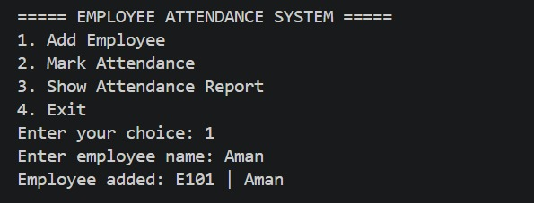
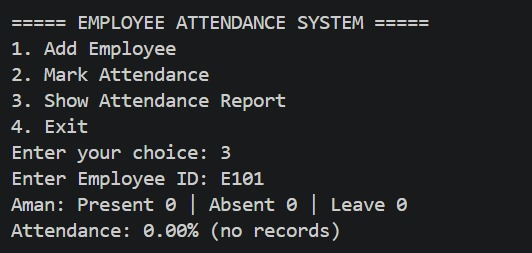
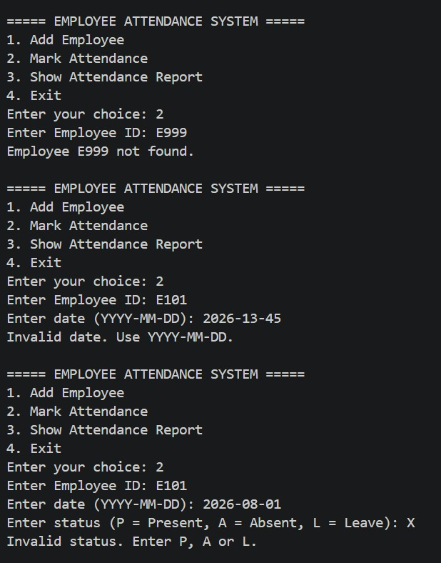
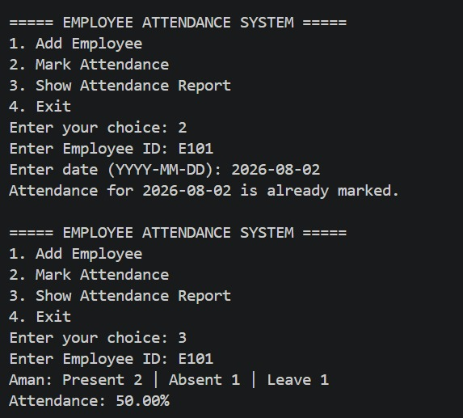

# Summary: Employee Attendance System (PS 32)

## 1. Project Statement

The PS asks for a console application that adds employees, marks their daily attendance as Present, Absent or Leave, and shows an attendance report for each employee. The data must be saved to a file so it is still available the next time the program runs.

The main requirements are:

- Written in Python 3, as one `.py` file('employee_attendance.py), run from the console.
- Employee IDs start from E101.
- Status codes: P (Present), A (Absent), L (Leave). Dates use `YYYY-MM-DD`.
- Attendance % = Present days ÷ marked days × 100.
- The same date cannot be marked twice for one employee.
- Concepts: dictionaries, lists, conditions and file handling.

## 2. Implementation

The program is divided into small functions, with one job each:

| Function | What it does |
|----------|--------------|
| `load_data()` | Reads `attendance.txt` at startup. `EMP` lines create employees, and `ATT` lines add their records. If the file does not exist yet, it does nothing. |
| `save_data()` | Rewrites the whole file. It writes an `EMP` line for each employee, followed by their `ATT` lines. |
| `add_employee()` | Asks for a name, rejects a blank one, finds the next free ID starting from E101, and saves. |
| `mark_attendance()` | Checks the ID, then the date, then the duplicate, then the status, and saves the record. |
| `show_report()` | Counts the P, A and L records for one employee and prints the counts and percentage. |
| `main()` | Loads the data, shows the menu in a loop, and saves when the user exits. |

### How the data is stored in memory

All employees are kept in one dictionary called `employees`. The key is the employee ID, and the value holds the name and a list of attendance records:

```python
employees = {
    "E101": {
        "name": "Aman",
        "attendance": [
            {"date": "2026-08-01", "status": "P"},
            {"date": "2026-08-02", "status": "P"},
        ],
    }
}
```

Using the ID as the key makes it quick to find an employee. Each record is a small dictionary, which keeps the date and status together.

### Order of checks in mark_attendance

The function stops at the first failed check:

1. The employee ID must exist.
2. The date must be valid.
3. The date must not already have a record.
4. The status must be P, A or L.

The duplicate check runs before the status is asked for. This means a repeated date is rejected straight away, without asking for a status first.

### Date checking

The date is checked with Python's `datetime` module, using `strptime` with the format `%Y-%m-%d`. If the text does not match that format, or describes a date that does not exist, it raises a `ValueError`, and the program prints the error message.

### Saving and loading

`save_data()` writes the whole dictionary back to the file every time something changes, so the file always matches memory. `load_data()` reads the file line by line. It splits each line on `|`. An `EMP` line creates a new employee, and an `ATT` line is added to the employee whose ID it names, if that employee exists.

## 3. Test Cases

Each test case was run on a fresh session. Screenshots are in the `screenshots` folder.

### Test Case 1: Add an employee

Input: add the name `Aman`.

Expected: `Employee added: E101 | Aman`





### Test Case 2: Report before any marks

Input: report for `E101`.

Expected: `Aman: Present 0 | Absent 0 | Leave 0` and `Attendance: 0.00% (no records)`





### Test Case 3: Invalid input

Input: mark `E999`, then `E101` with date `2026-13-45`, then `E101` with status `X`.

Expected: `Employee E999 not found.`, `Invalid date. Use YYYY-MM-DD.`, and `Invalid status. Enter P, A or L.` Nothing is saved.





### Test Case 4: Multiple marks and a duplicate

Input: mark `2026-08-01` P, `2026-08-02` P, `2026-08-03` A, `2026-08-04` L, then `2026-08-02` P again.

Expected: the duplicate is rejected with `Attendance for 2026-08-02 is already marked.` The report then shows `Aman: Present 2 | Absent 1 | Leave 1` and `Attendance: 50.00%`.





## 4. Conclusion

The program meets the PS requirements. It adds employees, records attendance, blocks duplicate dates, produces the report, and saves everything to a file that loads again on the next run. The test cases give the expected output.

The main lesson from this project was how data moves between a file and memory. Once the `EMP` and `ATT` lines were saved and loaded consistently, the rest of the program worked reliably.

## 5. Challenges Faced

- **Output differences from the PS.** Small differences in spacing and punctuation caused mismatches with the expected output. Comparing each print statement with the PS line by line fixed them.
- **Duplicate checks.** The duplicate check had to compare against the saved records, not just the current input, so repeated dates across sessions are also caught.
- **Pipe characters in names.** A name containing `|` would break the file format. I noted it as a limitation rather than adding extra checks, since the PS does not ask for them.
- **Date validation.** Checking dates by hand is error-prone, so `datetime` was used for correctness. This is the one module the program imports, and it can be replaced with manual checks if the course restricts imports.